# ERD — Entity Relationship Diagram
# InvenKopi — Sistem Informasi Manajemen Inventaris Coffeeshop OMORA
# Aktivitas D2-02

**Versi:** 1.0  
**Tanggal:** 2026-11-20  
**Disusun oleh:** Divisi 2 — Database & Backend (Kirana Ayu Dwi Putri)  
**Notasi:** Crow's Foot (Mermaid `erDiagram`)

---

## Daftar Tabel

### Master Data
| Tabel | Deskripsi |
|---|---|
| `m_user` | Pengguna sistem (Owner, Supervisor, Staf/Barista) |
| `m_outlet` | Outlet / lokasi operasional coffeeshop |
| `m_supplier` | Pemasok / vendor bahan baku |
| `m_item` | Master material / bahan baku |
| `m_menu` | Master menu minuman/makanan |

### Data Resep
| Tabel | Deskripsi |
|---|---|
| `t_bom` | Bill of Materials — komposisi bahan per menu |

### Transaksi Inventaris
| Tabel | Deskripsi |
|---|---|
| `t_penjualan` | Header transaksi penjualan per shift |
| `t_penjualan_detail` | Detail item menu yang terjual |
| `t_penerimaan` | Header penerimaan barang dari supplier |
| `t_penerimaan_detail` | Detail baris material yang diterima |
| `t_transfer` | Header transfer stok antar outlet |
| `t_transfer_detail` | Detail baris material yang dipindahkan |
| `t_waste` | Pencatatan waste / pembuangan material |
| `t_stock_opname` | Header stock opname per periode per outlet |
| `t_stock_opname_detail` | Detail hasil hitung fisik per material |

### Stok & Referensi
| Tabel | Deskripsi |
|---|---|
| `t_stock_ledger` | Kartu stok / riwayat mutasi stok per item per outlet |
| `r_begin_stock` | Stok awal per item per outlet per periode |

---

## ERD (Mermaid Crow's Foot)

```mermaid
erDiagram

    %% =============================================
    %% MASTER DATA
    %% =============================================

    m_user {
        int id PK
        varchar username UK
        varchar email UK
        varchar password
        enum role
        boolean is_active
        timestamp created_at
        timestamp updated_at
    }

    m_outlet {
        int id PK
        varchar kode_outlet UK
        varchar nama_outlet
        text alamat
        varchar telepon
        boolean is_active
        timestamp created_at
        timestamp updated_at
    }

    m_supplier {
        int id PK
        varchar kode_supplier UK
        varchar nama_supplier
        varchar kontak_person
        varchar telepon
        text alamat
        boolean is_active
        timestamp created_at
        timestamp updated_at
    }

    m_item {
        int id PK
        varchar sku UK
        varchar nama_item
        enum tipe_material
        enum satuan_ecer
        enum satuan_utuh
        decimal pack_standard
        decimal stok_minimum
        boolean is_active
        timestamp created_at
        timestamp updated_at
    }

    m_menu {
        int id PK
        varchar kode_menu UK
        varchar nama_menu
        varchar kategori
        decimal harga
        boolean is_active
        timestamp created_at
        timestamp updated_at
    }

    %% =============================================
    %% DATA RESEP
    %% =============================================

    t_bom {
        int id PK
        int menu_id FK
        int item_id FK
        decimal qty_per_porsi
        enum satuan
        timestamp created_at
        timestamp updated_at
    }

    %% =============================================
    %% TRANSAKSI PENJUALAN
    %% =============================================

    t_penjualan {
        int id PK
        varchar no_dokumen UK
        date tanggal
        int outlet_id FK
        int user_id FK
        enum shift
        text catatan
        enum status
        timestamp created_at
        timestamp updated_at
    }

    t_penjualan_detail {
        int id PK
        int penjualan_id FK
        int menu_id FK
        decimal qty
        decimal harga_satuan
        timestamp created_at
        timestamp updated_at
    }

    %% =============================================
    %% TRANSAKSI PENERIMAAN
    %% =============================================

    t_penerimaan {
        int id PK
        varchar no_dokumen UK
        date tanggal
        int outlet_id FK
        int supplier_id FK
        int user_id FK
        text catatan
        enum status
        timestamp created_at
        timestamp updated_at
    }

    t_penerimaan_detail {
        int id PK
        int penerimaan_id FK
        int item_id FK
        decimal qty_utuh
        decimal qty_ecer
        decimal total_ecer
        timestamp created_at
        timestamp updated_at
    }

    %% =============================================
    %% TRANSAKSI TRANSFER
    %% =============================================

    t_transfer {
        int id PK
        varchar no_dokumen UK
        date tanggal
        int outlet_asal_id FK
        int outlet_tujuan_id FK
        int user_id FK
        text catatan
        enum status
        timestamp created_at
        timestamp updated_at
    }

    t_transfer_detail {
        int id PK
        int transfer_id FK
        int item_id FK
        decimal qty_ecer
        timestamp created_at
        timestamp updated_at
    }

    %% =============================================
    %% WASTE
    %% =============================================

    t_waste {
        int id PK
        varchar no_dokumen UK
        date tanggal
        int outlet_id FK
        int item_id FK
        int user_id FK
        decimal qty_ecer
        varchar alasan
        text catatan
        timestamp created_at
        timestamp updated_at
    }

    %% =============================================
    %% STOCK OPNAME
    %% =============================================

    t_stock_opname {
        int id PK
        varchar no_dokumen UK
        date tanggal
        int outlet_id FK
        int user_id FK
        enum status
        text catatan
        timestamp created_at
        timestamp updated_at
    }

    t_stock_opname_detail {
        int id PK
        int stock_opname_id FK
        int item_id FK
        decimal sisa_utuh
        decimal sisa_ecer
        decimal total_ecer
        timestamp created_at
        timestamp updated_at
    }

    %% =============================================
    %% STOK & REFERENSI
    %% =============================================

    t_stock_ledger {
        int id PK
        int outlet_id FK
        int item_id FK
        date tanggal
        enum jenis_mutasi
        varchar referensi_id
        varchar referensi_tipe
        decimal qty_masuk
        decimal qty_keluar
        decimal saldo_ecer
        timestamp created_at
    }

    r_begin_stock {
        int id PK
        int outlet_id FK
        int item_id FK
        varchar periode
        decimal qty_ecer
        int user_id FK
        timestamp created_at
        timestamp updated_at
    }

    %% =============================================
    %% RELASI
    %% =============================================

    %% Outlet - User
    m_outlet ||--o{ m_user : "user_outlet (melalui pivot)"

    %% BOM: menu memiliki banyak bahan
    m_menu ||--o{ t_bom : "memiliki resep"
    m_item ||--o{ t_bom : "digunakan dalam"

    %% Penjualan
    m_outlet ||--o{ t_penjualan : "dicatat di"
    m_user ||--o{ t_penjualan : "dicatat oleh"
    t_penjualan ||--o{ t_penjualan_detail : "berisi"
    m_menu ||--o{ t_penjualan_detail : "menu terjual"

    %% Penerimaan
    m_outlet ||--o{ t_penerimaan : "diterima di"
    m_supplier ||--o{ t_penerimaan : "dipasok oleh"
    m_user ||--o{ t_penerimaan : "diterima oleh"
    t_penerimaan ||--o{ t_penerimaan_detail : "berisi"
    m_item ||--o{ t_penerimaan_detail : "item diterima"

    %% Transfer
    m_outlet ||--o{ t_transfer : "outlet asal"
    m_outlet ||--o{ t_transfer : "outlet tujuan"
    m_user ||--o{ t_transfer : "dicatat oleh"
    t_transfer ||--o{ t_transfer_detail : "berisi"
    m_item ||--o{ t_transfer_detail : "item dipindahkan"

    %% Waste
    m_outlet ||--o{ t_waste : "terjadi di"
    m_item ||--o{ t_waste : "material terbuang"
    m_user ||--o{ t_waste : "dicatat oleh"

    %% Stock Opname
    m_outlet ||--o{ t_stock_opname : "dihitung di"
    m_user ||--o{ t_stock_opname : "dihitung oleh"
    t_stock_opname ||--o{ t_stock_opname_detail : "berisi"
    m_item ||--o{ t_stock_opname_detail : "item dihitung"

    %% Stock Ledger
    m_outlet ||--o{ t_stock_ledger : "mutasi di"
    m_item ||--o{ t_stock_ledger : "mutasi item"

    %% Begin Stock
    m_outlet ||--o{ r_begin_stock : "stok awal di"
    m_item ||--o{ r_begin_stock : "stok awal item"
    m_user ||--o{ r_begin_stock : "diinput oleh"
```

---

## Penjelasan Entitas & Relasi

### Master Data

#### `m_user` — Pengguna Sistem
Menyimpan akun pengguna yang dapat masuk ke sistem. Kolom `role` menggunakan ENUM dengan nilai `owner`, `supervisor`, `staff`. Password harus disimpan dalam bentuk hash (bcrypt via Laravel). Username dan email bersifat unik.

**Relasi:**
- Mencatat transaksi penjualan, penerimaan, transfer, waste, stock opname, dan begin stock (1:N).

#### `m_outlet` — Outlet / Lokasi
Data outlet operasional. OMORA Coffeeshop saat ini beroperasi di 1 outlet, tetapi desain mendukung multi-outlet sesuai kebutuhan skalabilitas.

**Relasi:**
- Menjadi lokasi seluruh transaksi inventaris (penjualan, penerimaan, transfer asal/tujuan, waste, stock opname, ledger, begin stock).

#### `m_supplier` — Pemasok
Direktori vendor / pemasok bahan baku.

**Relasi:**
- Dihubungkan ke `t_penerimaan` (1:N).

#### `m_item` — Material / Bahan Baku
Master data bahan baku. Menyimpan tipe material (DRY, FRS, FRZ, PKG), satuan ecer (G, ML, PC), satuan utuh (POC, PAC, BOX, CAR), isi per kemasan utuh (`pack_standard`), dan stok minimum.

**Relasi:**
- Menjadi komponen BOM, item dalam penerimaan, transfer, waste, stock opname, ledger, dan begin stock.

#### `m_menu` — Menu
Master menu minuman/makanan yang dijual.

**Relasi:**
- Memiliki BOM (resep bahan baku).
- Dijual dalam transaksi penjualan.

---

### Data Resep

#### `t_bom` — Bill of Materials
Menyimpan komposisi bahan baku per porsi menu. Satu menu dapat memiliki banyak bahan (1:N dari `m_menu`), dan satu bahan dapat digunakan di banyak menu (1:N dari `m_item`).

Rumus usage:
> Usage = qty_terjual × qty_per_porsi (dari t_bom)

---

### Transaksi Inventaris

#### `t_penjualan` + `t_penjualan_detail`
Header menyimpan informasi shift, outlet, petugas, dan tanggal. Detail menyimpan menu yang terjual beserta kuantitas. Pemisahan header-detail memungkinkan satu transaksi penjualan mencakup banyak menu.

#### `t_penerimaan` + `t_penerimaan_detail`
Header menyimpan nomor dokumen, tanggal, supplier, outlet tujuan. Detail menyimpan per-item: qty dalam satuan utuh, satuan ecer, dan total ecer yang dihitung.

Rumus: `total_ecer = (qty_utuh × pack_standard_item) + qty_ecer`

#### `t_transfer` + `t_transfer_detail`
Header menyimpan outlet asal dan tujuan. Detail menyimpan item dan kuantitas yang dipindahkan dalam satuan ecer.

#### `t_waste`
Satu record per kejadian pembuangan. Menyimpan outlet, item, kuantitas ecer, dan alasan waste.

#### `t_stock_opname` + `t_stock_opname_detail`
Header menyimpan tanggal, outlet, petugas penghitung. Detail menyimpan sisa utuh, sisa ecer, dan total ecer per item hasil hitung fisik.

Rumus: `total_ecer = (sisa_utuh × pack_standard_item) + sisa_ecer`

---

### Stok & Referensi

#### `t_stock_ledger` — Kartu Stok / Buku Besar Mutasi
Mencatat setiap perubahan stok (masuk/keluar) beserta saldo setelah mutasi, per item per outlet. Kolom `referensi_tipe` dan `referensi_id` merekam dokumen asal mutasi (penerimaan, transfer, waste, opname, penjualan).

Ini memungkinkan rekonstruksi perjalanan stok dan perhitungan `Std. End Stock` tanpa bergantung hanya pada agregasi semua tabel transaksi.

#### `r_begin_stock` — Stok Awal
Menyimpan stok awal per item per outlet per periode (format `YYYY-MM`, misalnya `2026-11`). Dibutuhkan untuk menghitung:

> Std. End Stock = Begin Stock + Receive + Trf In − Trf Out − Waste − Usage

---

## Kardinalitas Relasi Utama

| Relasi | Kardinalitas | Keterangan |
|---|---|---|
| m_menu → t_bom | 1 : N | Satu menu memiliki banyak bahan |
| m_item → t_bom | 1 : N | Satu bahan dipakai di banyak resep |
| t_penjualan → t_penjualan_detail | 1 : N | Satu penjualan berisi banyak menu |
| t_penerimaan → t_penerimaan_detail | 1 : N | Satu penerimaan berisi banyak item |
| t_transfer → t_transfer_detail | 1 : N | Satu transfer berisi banyak item |
| t_stock_opname → t_stock_opname_detail | 1 : N | Satu opname berisi banyak item |
| m_outlet → t_transfer (asal & tujuan) | 1 : N (×2) | Outlet berperan sebagai asal DAN tujuan |
| m_item → t_stock_ledger | 1 : N | Satu item memiliki banyak mutasi stok |
| m_outlet → r_begin_stock + m_item → r_begin_stock | 1:N (×2) | Kombinasi outlet + item + periode = unik |
