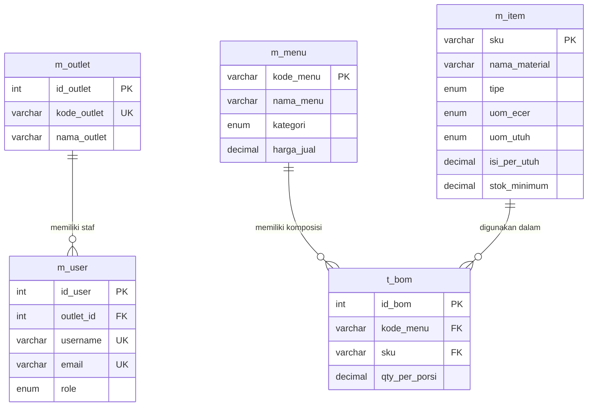
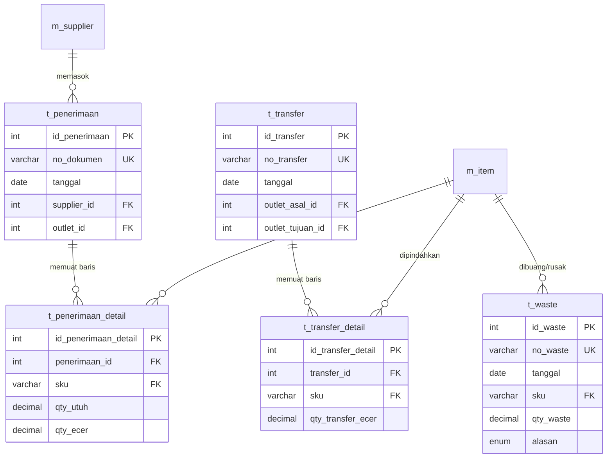
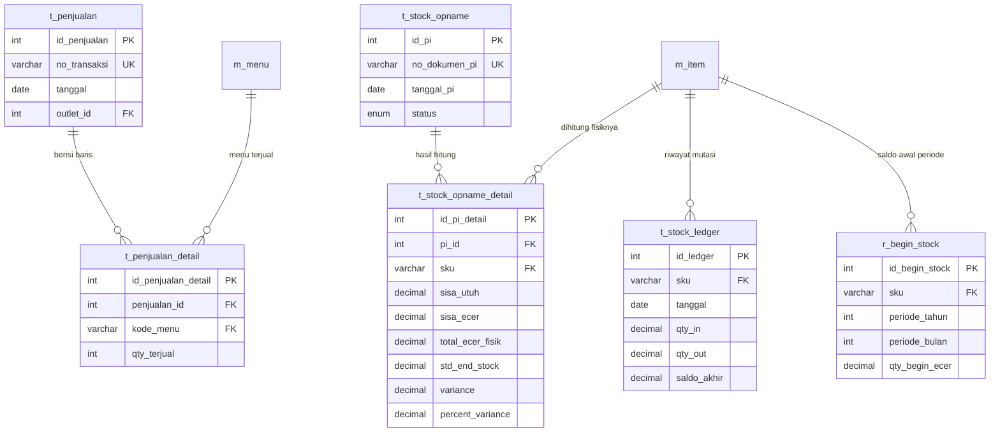

# ERD — Entity Relationship Diagram (Format Portrait)
# InvenKopi — Sistem Informasi Manajemen Inventaris Coffeeshop OMORA
# Aktivitas D2-02

**Versi:** 2.0 (Optimasi Format Portrait & Tipografi Jelas)  
**Tanggal:** 22 November 2026  
**Disusun oleh:** Kirana Ayu Dwi Putri (NIM: 24.N1.0028) — Database Administrator & Backend Developer  
**Format Visual:** Dioptimalkan khusus untuk Halaman Berorientasi **Portrait (Tegak/A4)** pada Dokumen Word Laporan Teknis.

---

## 1. Panduan Penggunaan pada Dokumen Word (.docx) Format Portrait

Untuk mengatasi masalah diagram yang teksnya terlalu kecil/pecah saat dimasukkan ke halaman Word Portrait, tersedia dua cara terbaik:

1. **Cara Vektor SVG (Rekomendasi Utama — Kualitas 100% Tajam):**
   - Sisipkan file [`docs/database/ERD_portrait.svg`](ERD_portrait.svg) langsung ke dokumen Word kamu (*Insert &rarr; Pictures &rarr; This Device*, lalu pilih file `.svg`).
   - Word 2016/2019/365 mendukung SVG secara *native*. Teks dan garis diagram akan tetap tajam dan tidak pecah meskipun di-zoom hingga 500%.
2. **Cara Salin dari Browser:**
   - Buka file [`docs/database/erd_preview.html`](erd_preview.html) di browser (Google Chrome atau Microsoft Edge).
   - Klik kanan pada diagram &rarr; pilih *Salin Gambar (Copy Image)* &rarr; *Paste* ke dokumen Word pada halaman berformat Portrait.
3. **Menggunakan Kode Mermaid di Bawah:**
   - Salin kode Mermaid di bawah ke [Mermaid Live Editor](https://mermaid.live) atau pratinjau markdown di VS Code.

---

## 2. Diagram ERD Utama: Arsitektur Vertikal Lengkap (Mermaid Portrait)

Diagram ini mengelompokkan 18 tabel ke dalam 4 tingkatan (*tier*) vertikal (Atas ke Bawah / `flowchart TD`). Dengan rasio tinggi yang lebih besar dari lebar (~1 : 1.5), seluruh teks atribut, primary key (🔑), foreign key (🔗), dan tipe data dapat dibaca dengan sangat jelas tanpa harus diputar ke format landscape.

```mermaid
flowchart TD
%% =======================================================
%% ERD INVENKOPI OMORA — STRUKTUR VERTIKAL (PORTRAIT A4)
%% =======================================================

    subgraph TIER1 ["1. TIER MASTER DATA"]
        direction LR
        m_user["<b>m_user</b><br/>━━━━━━━━━━━━━━<br/>🔑 <b>id_user</b> : INT<br/>🔗 outlet_id : INT (FK)<br/>• username : VARCHAR(50)<br/>• email : VARCHAR(100)<br/>• password_hash : VARCHAR<br/>• role : ENUM<br/>• is_active : BOOL"]
        m_outlet["<b>m_outlet</b><br/>━━━━━━━━━━━━━━<br/>🔑 <b>id_outlet</b> : INT<br/>• kode_outlet : VARCHAR(10)<br/>• nama_outlet : VARCHAR(100)<br/>• alamat : TEXT<br/>• no_telepon : VARCHAR<br/>• is_active : BOOL"]
        m_supplier["<b>m_supplier</b><br/>━━━━━━━━━━━━━━<br/>🔑 <b>id_supplier</b> : INT<br/>• kode_supplier : VARCHAR<br/>• nama_supplier : VARCHAR<br/>• kontak_person : VARCHAR<br/>• no_telepon : VARCHAR<br/>• is_active : BOOL"]
        m_item["<b>m_item</b><br/>━━━━━━━━━━━━━━<br/>🔑 <b>sku</b> : VARCHAR(10)<br/>• nama_material : VARCHAR<br/>• tipe : ENUM(DRY,FRS..)<br/>• uom_ecer : (G,ML,PC)<br/>• uom_utuh : (PAC,CAR..)<br/>• isi_per_utuh : DECIMAL<br/>• stok_minimum : DECIMAL"]
        m_menu["<b>m_menu</b><br/>━━━━━━━━━━━━━━<br/>🔑 <b>kode_menu</b> : VARCHAR(10)<br/>• nama_menu : VARCHAR(100)<br/>• kategori : ENUM<br/>• harga_jual : DECIMAL<br/>• is_active : BOOL"]
    end

    subgraph TIER2 ["2. TIER RESEP & TRANSAKSI HEADER"]
        direction LR
        t_bom["<b>t_bom</b> (Resep / BOM)<br/>━━━━━━━━━━━━━━<br/>🔑 <b>id_bom</b> : INT<br/>🔗 kode_menu : VARCHAR (FK)<br/>🔗 sku : VARCHAR (FK)<br/>• qty_per_porsi : DECIMAL<br/>• catatan : TEXT"]
        t_penjualan["<b>t_penjualan</b><br/>━━━━━━━━━━━━━━<br/>🔑 <b>id_penjualan</b> : INT<br/>• no_transaksi : VARCHAR<br/>• tanggal : DATE<br/>🔗 outlet_id : INT (FK)<br/>🔗 user_id : INT (FK)<br/>• total_cup / omzet"]
        t_penerimaan["<b>t_penerimaan</b><br/>━━━━━━━━━━━━━━<br/>🔑 <b>id_penerimaan</b> : INT<br/>• no_dokumen : VARCHAR<br/>• tanggal : DATE<br/>🔗 outlet_id : INT (FK)<br/>🔗 supplier_id : INT (FK)<br/>🔗 user_id : INT (FK)"]
        t_transfer["<b>t_transfer</b><br/>━━━━━━━━━━━━━━<br/>🔑 <b>id_transfer</b> : INT<br/>• no_transfer : VARCHAR<br/>• tanggal : DATE<br/>🔗 outlet_asal_id : INT<br/>🔗 outlet_tujuan_id: INT<br/>🔗 user_id : INT (FK)"]
        t_waste["<b>t_waste</b> (Limbah Bar)<br/>━━━━━━━━━━━━━━<br/>🔑 <b>id_waste</b> : INT<br/>• no_waste : VARCHAR<br/>• tanggal : DATE<br/>🔗 outlet_id : INT (FK)<br/>🔗 sku : VARCHAR (FK)<br/>🔗 user_id : INT (FK)<br/>• qty_waste : DECIMAL"]
    end

    subgraph TIER3 ["3. TIER TRANSAKSI DETAIL"]
        direction LR
        t_penjualan_detail["<b>t_penjualan_detail</b><br/>━━━━━━━━━━━━━━<br/>🔑 <b>id_penjualan_detail</b><br/>🔗 penjualan_id : INT (FK)<br/>🔗 kode_menu : VARCHAR (FK)<br/>• qty_terjual : INT<br/>• harga_satuan : DECIMAL"]
        t_penerimaan_detail["<b>t_penerimaan_detail</b><br/>━━━━━━━━━━━━━━<br/>🔑 <b>id_penerimaan_detail</b><br/>🔗 penerimaan_id : INT (FK)<br/>🔗 sku : VARCHAR (FK)<br/>• qty_utuh / isi_per_utuh<br/>• qty_ecer : DECIMAL"]
        t_transfer_detail["<b>t_transfer_detail</b><br/>━━━━━━━━━━━━━━<br/>🔑 <b>id_transfer_detail</b><br/>🔗 transfer_id : INT (FK)<br/>🔗 sku : VARCHAR (FK)<br/>• qty_transfer_ecer : DEC"]
    end

    subgraph TIER4 ["4. TIER KONTROL STOK, OPNAME & AUDIT"]
        direction LR
        r_begin_stock["<b>r_begin_stock</b> (Saldo Awal)<br/>━━━━━━━━━━━━━━<br/>🔑 <b>id_begin_stock</b> : INT<br/>🔗 outlet_id : INT (FK)<br/>🔗 sku : VARCHAR (FK)<br/>• periode_tahun / bulan / ke<br/>• qty_begin_ecer : DECIMAL"]
        t_stock_opname["<b>t_stock_opname</b><br/>━━━━━━━━━━━━━━<br/>🔑 <b>id_pi</b> : INT<br/>• no_dokumen_pi : VARCHAR<br/>• tanggal_pi : DATE<br/>🔗 outlet_id : INT (FK)<br/>🔗 user_id : INT (FK)<br/>• status : ENUM"]
        t_stock_opname_detail["<b>t_stock_opname_detail</b><br/>━━━━━━━━━━━━━━<br/>🔑 <b>id_pi_detail</b> : INT<br/>🔗 pi_id : INT (FK)<br/>🔗 sku : VARCHAR (FK)<br/>• sisa_utuh / sisa_ecer<br/>• total_ecer_fisik : DEC<br/>• std_end_stock : DEC<br/>• variance / %variance"]
        t_stock_ledger["<b>t_stock_ledger</b> (Kartu Stok)<br/>━━━━━━━━━━━━━━<br/>🔑 <b>id_ledger</b> : INT<br/>🔗 outlet_id : INT (FK)<br/>🔗 sku : VARCHAR (FK)<br/>• tanggal : DATE<br/>• ref_tipe &bull; ref_id<br/>• qty_in / qty_out / saldo"]
        t_log_aktivitas["<b>t_log_aktivitas</b> (Audit)<br/>━━━━━━━━━━━━━━<br/>🔑 <b>id_log</b> : BIGINT<br/>🔗 user_id : INT (FK)<br/>• aksi &bull; modul<br/>• detail_perubahan : JSON"]
    end

    %% Relasi Alur Data
    m_outlet -.->|1 : N| m_user
    m_menu -->|1 : N| t_bom
    m_item -->|1 : N| t_bom

    m_outlet -.-> t_penjualan
    t_penjualan -->|1 : N| t_penjualan_detail
    m_menu -.->|1 : N| t_penjualan_detail

    m_supplier -->|1 : N| t_penerimaan
    t_penerimaan -->|1 : N| t_penerimaan_detail
    m_item -.->|1 : N| t_penerimaan_detail

    m_outlet -.->|Asal & Tujuan| t_transfer
    t_transfer -->|1 : N| t_transfer_detail
    m_item -.->|1 : N| t_transfer_detail

    m_item -->|1 : N| t_waste

    t_stock_opname -->|1 : N| t_stock_opname_detail
    m_item -.->|1 : N| t_stock_opname_detail

    m_item -.->|1 : N| r_begin_stock
    m_item -.->|1 : N| t_stock_ledger
    m_user -.->|1 : N| t_log_aktivitas

    classDef master fill:#eff6ff,stroke:#1d4ed8,stroke-width:1.5px,color:#0f172a;
    classDef resep fill:#ecfdf5,stroke:#047857,stroke-width:1.5px,color:#0f172a;
    classDef trx fill:#fefce8,stroke:#a16207,stroke-width:1.5px,color:#0f172a;
    classDef stock fill:#faf5ff,stroke:#7e22ce,stroke-width:1.5px,color:#0f172a;

    class m_user,m_outlet,m_supplier,m_item,m_menu master;
    class t_bom resep;
    class t_penjualan,t_penerimaan,t_transfer,t_waste,t_penjualan_detail,t_penerimaan_detail,t_transfer_detail trx;
    class r_begin_stock,t_stock_opname,t_stock_opname_detail,t_stock_ledger,t_log_aktivitas stock;
```

---

## 3. Alternatif: Sub-ERD per Domain (Notasi Crow's Foot Murni)

Jika dosen pengampu atau pembimbing meminta diagram disajikan per sub-bab pembahasan dalam orientasi Portrait, gunakan tiga potongan Sub-ERD berikut:

### Sub-ERD A: Domain Master Data & Resep (BOM)

### Sub-ERD B: Domain Transaksi Logistik & Limbah Bar (Penerimaan, Transfer, Waste)

### Sub-ERD C: Domain Penjualan, Stock Opname, Kartu Stok & Saldo Awal

---

## 4. Keunggulan Format Baru ini untuk Laporan DOCX

1. **Rasio Aspek Vertikal Tepat (A4 Portrait):**
   Diagram disusun secara 4-tier dari atas ke bawah, bukan menyamping, sehingga lebarnya hanya ~900px dan tingginya ~1420px. Ketika disematkan ke halaman Word berorientasi potrait, diagram tidak akan terkompresi secara horizontal.
2. **Ukuran Huruf Proporsional:**
   Ukuran font di dalam setiap kotak tabel dirancang setara dengan 10–11.5pt, sehingga saat dicetak pada kertas A4 standar, semua nama kolom, tipe data, dan relasi langsung terbaca dengan jelas tanpa perlu kaca pembesar.
3. **Format SVG Vektor yang Fleksibel:**
   Berkas `ERD_portrait.svg` dapat langsung di-drag ke Microsoft Word tanpa konversi PNG berulang-ulang, menghasilkan cetakan yang tajam (anti-blur).
